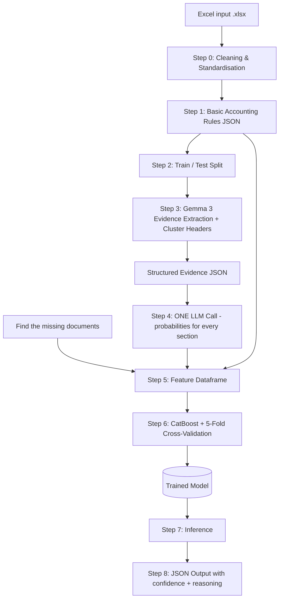
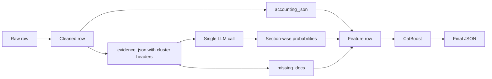

# 1. Project Name
 
**VYOM+ VoucherSense: Evidence-Driven Voucher Classification with an Open-Source LLM and Gradient Boosting**
 
> An open-source LLM (Gemma 3) *reads and reasons* over structured transaction data, and a CatBoost meta-classifier *decides* using the LLM's section-wise probabilities plus deterministic accounting signals.
 
---
 
# 2. Problem Statement
 
Given an Excel file of already-structured transactions (seller, buyer, invoice number/date, items, taxable value, GST, discounts, freight, payment info, currency, payroll fields, debit/credit info, return info, order/delivery references, etc.), predict **one voucher category** per row from 27 classes: Purchase, Sales, Purchase Return / Debit Note, Sales Return / Credit Note, Payment, Receipt, Contra, Journal, Salary / Payroll, Attendance, Purchase Order, Sales Order, Receipt Note, Delivery Note, Rejection In, Rejection Out, Stock Journal, Physical Stock, Material In, Material Out, Job Work In Order, Job Work Out Order, Import, Export, Expense, Advance / Prepayment, Other / Miscellaneous.
 
Constraints and difficulty:
 
- The voucher-type column is intentionally **missing**.
- This is **not** OCR or invoice extraction; the input is already structured.
- The hard part is **semantic disambiguation**: Purchase vs Sales, Purchase Return vs Sales Return, Contra vs Payment/Receipt, Journal vs Purchase/Sales, inventory movements vs commercial invoices, Import/Export vs domestic.
- Data may be **missing, incomplete, or ambiguous**.
- The primary intelligence layer must be an **open-source / openly available** model.
---
 
# 3. Project Overview
 
VoucherSense is a two-layer classifier:
 
1. **Reasoning layer (LLM):** Gemma 3 converts each raw row into a structured *evidence JSON*. Related details are grouped into clusters (money, documents, parties, goods, ...), and every cluster carries a **cluster header** that states its meaning. The whole evidence JSON is then sent in **one single LLM call**, which returns a probability distribution for **each section** in one response.
2. **Decision layer (CatBoost):** The section-wise probabilities are combined with deterministic accounting features (currency, GST structure, our role, document-presence flags, missing-document list) and fed to a gradient-boosted model that learns how much to trust each section for each class. The model is tuned with **5-fold stratified cross-validation** and evaluated once on a held-out test set.
The final output is a JSON record per transaction with `invoice_id`, `voucher_type`, `confidence`, and `reasoning`.
 
---
 
# 4. Proposed Solution
 
| Step | What happens |
|------|--------------|
| **0** | Clean and standardise the data (dates, numbers, currency codes, party names, nulls, casing). |
| **1** | Rule-based *basic accounting* layer produces a JSON of hard facts (e.g., foreign currency ⇒ Import/Export signal, GST present, our role as buyer/seller, debit/credit direction, return markers). |
| **2** | Split the dataset into train and test (stratified, grouped by invoice/party). The training set is further used for **5-fold stratified cross-validation**. |
| **3** | Gemma 3 extracts **evidence** from each record and clusters it into a structured JSON (`money`, `documents`, `parties`, `goods`, ...). Each cluster has a **`cluster_header`** key describing what that cluster means. |
| **4** | The full evidence JSON goes to the LLM. The LLM predicts probabilities **for each section** in the same response. |
| **5** | The section-wise probabilities and outcomes are stored in a new dataframe together with the Step 1 accounting features and an **explicit list of missing documents**. |
| **6** | A boosting model (CatBoost) is trained on this dataframe. Settings are tuned with 5-fold cross-validation and the final model is tested on the held-out test set. |
| **7** | At inference time, the trained CatBoost model produces the final prediction. |
| **8** | Output is emitted as JSON: invoice id, voucher type, confidence, reasoning. |
 
---
 
# 5. Objectives
 
- Predict the correct voucher category from structured data with high accuracy and macro-F1 across all 27 classes.
- Reason over **combinations of fields**, not single keywords.
- Use an **open-source LLM as the primary reasoning engine**.
- Keep inference **fast** with a single LLM call per transaction.
- Produce **programmatically evaluable, consistent JSON** with confidence and a short explanation.
- Provide a **reproducible** train / cross-validate / evaluate / infer pipeline that runs on modest hardware.
---
 
# 6. Target Users / Use Case
 
- **Accounting automation platforms** that need a bridge between invoice extraction and automated voucher creation (the VYOM+ context).
- **Accountants and CA firms** who bulk-import transactions and want voucher types pre-assigned for review.
- **Finance teams and auditors** who want an explanation for why a record was classified a certain way.
---
 
# 7. Open-Source AI Technology Selected
 
| Component | Technology |
|-----------|------------|
| Reasoning LLM | **Gemma 3**  |
| Structured output | JSON-schema |
| Meta-classifier | **CatBoost** (Apache 2.0) |
| Validation | **scikit-learn** (`StratifiedKFold` / `StratifiedGroupKFold`) |
| Data handling | pandas, openpyxl |
 
---
 
# 8. Why This Technology Was Selected
 
- **Gemma 3:** strong instruction following and JSON generation at small sizes, multilingual (useful for Indian invoices with mixed-language descriptions), runs locally with quantization, and is openly available.
- **Hybrid LLM + boosting instead of LLM-only:** LLMs are good at semantics but poorly calibrated and sometimes inconsistent. CatBoost learns *when* each section's prediction is reliable, corrects systematic biases (e.g., Purchase/Sales confusion), and yields **calibrated confidence**.
- **Cluster headers:** a short meaning attached to each cluster (for example, "money: amounts, tax, and direction of cash flow") tells the LLM exactly how to read the cluster, which reduces misinterpretation of ambiguous fields.
- **One call instead of three:** the LLM sees the full context once, so the system is about 3x faster on the LLM step, the prompt and the shared context (our role, currency) are not repeated, and the model can still give a separate probability for each section.
- **CatBoost specifically:** excellent with mixed categorical/numeric tabular features, handles missing values natively, strong on small/medium datasets, supports class weights for imbalance, and is fast at inference.
- **5-fold cross-validation:** gives a more reliable performance estimate than a single split. With 80% of the training data used per round, it is close to the final training size, and each fold still contains enough examples of rare voucher types.
- **Local inference:** data privacy for financial records, no per-call cost, reproducibility.
---
 
# 9. AI's Role in the System
 
| Layer | Role |
|-------|------|
| **Gemma 3 (extraction)** | Reads raw fields and organises them into evidence clusters with cluster headers: what money moved, which documents exist, who the parties are, what goods or services are involved. |
| **Gemma 3 (classification)** | In a single call, outputs a probability distribution over voucher types for each evidence section, plus a short rationale per section. |
| **Gemma 3 (explanation)** | Writes a concise reasoning string for the final prediction, grounded in the evidence and top features. |
| **CatBoost** | Fuses the section-wise probabilities with rule-based features and makes the final, calibrated decision. |
 
---
 
# 10. System Architecture
 

 
---
 
# 11. Component-Level Architecture
 
| # | Component | Responsibility | Input → Output |
|---|-----------|----------------|----------------|
| 1 | **Data Cleaner** | Normalise dates, amounts, currency codes, party names; handle nulls | Raw Excel → clean DataFrame |
| 2 | **Accounting Rules Engine** | Deterministic signals: foreign currency, GST present, our role (buyer/seller), Dr/Cr, return flags, payroll fields | Clean row → `accounting_json` |
| 3 | **Splitter** | Stratified train/test split grouped by invoice/party to avoid leakage | DataFrame → train / test |
| 4 | **Evidence Extractor (Gemma 3)** | Cluster raw fields into sections and add a `cluster_header` to each | Row → `evidence_json` |
| 5 | **Section Probability Classifier (Gemma 3, single call)** | Probability over the voucher classes for every section in one response | `evidence_json` → section-wise probabilities |
| 6 | **Missing-Document Detector** | Compares the row to an expected-documents table per voucher type | Row + evidence → `missing_docs`, completeness features |
| 7 | **Feature Builder** | Assembles probabilities, rule features, missing-doc flags, agreement metrics | All signals → feature DataFrame |
| 8 | **Meta-Classifier (CatBoost)** | Learns the final decision and calibrated confidence; tuned with 5-fold CV | Feature DataFrame → class + probabilities |
| 9 | **Explainer** | LLM-written reasoning | Prediction → reasoning text |
| 10 | **Output Formatter** | Schema-validated JSON | Prediction → final JSON |
| 11 | **Evaluator** | Accuracy, precision, recall, macro-F1, per-class report, confusion matrix, ablations | Predictions + ground truth → report |
 
---
 
# 12. Data / Information Flow
 

 
**Example evidence JSON with cluster headers (illustrative):**
 
```json
{
  "invoice_id": "INV-2026-1042",
  "money": {
    "cluster_header": "Amounts, tax, and direction of cash flow for this transaction",
    "currency": "INR",
    "taxable_value": 100000,
    "gst": 18000,
    "discount": 0,
    "freight": 500,
    "direction": "outflow",
    "payment_status": "unpaid"
  },
  "documents": {
    "cluster_header": "Documents and reference numbers that accompany this transaction",
    "invoice_number": "INV-2026-1042",
    "po_reference": "PO-889",
    "delivery_note": null,
    "grn": null,
    "credit_debit_note_ref": null
  },
  "parties": {
    "cluster_header": "Who is involved and what role our company plays",
    "seller": "ABC Traders",
    "buyer": "Our Company Pvt Ltd",
    "our_role": "buyer"
  },
  "goods": {
    "cluster_header": "Items, quantities, and delivery details",
    "items": ["Steel rods"],
    "quantity": 500,
    "delivery_info": null
  }
}
```
 
**Expected single-call LLM output (illustrative):**
 
```json
{
  "section_predictions": {
    "money": {
      "top_labels": [
        {"label": "Purchase", "prob": 0.72},
        {"label": "Expense", "prob": 0.18},
        {"label": "Payment", "prob": 0.05}
      ],
      "rationale": "Taxable value with GST and outflow direction."
    },
    "documents": {
      "top_labels": [
        {"label": "Purchase", "prob": 0.60},
        {"label": "Purchase Order", "prob": 0.22},
        {"label": "Receipt Note", "prob": 0.10}
      ],
      "rationale": "Invoice number with a PO reference; no delivery proof."
    },
    "parties": {
      "top_labels": [
        {"label": "Purchase", "prob": 0.85},
        {"label": "Sales", "prob": 0.03}
      ],
      "rationale": "Our company is the buyer."
    },
    "goods": {
      "top_labels": [
        {"label": "Purchase", "prob": 0.70},
        {"label": "Material In", "prob": 0.15}
      ],
      "rationale": "Goods are stock items."
    }
  }
}
```
 
**Per-row feature record stored for CatBoost:**
 
```json
{
  "money_top1": "Purchase", "money_p1": 0.72, "money_margin": 0.54,
  "documents_top1": "Purchase", "documents_p1": 0.60, "documents_margin": 0.38,
  "parties_top1": "Purchase", "parties_p1": 0.85, "parties_margin": 0.82,
  "goods_top1": "Purchase", "goods_p1": 0.70, "goods_margin": 0.55,
  "sections_agree": 1,
  "is_foreign_currency": 0,
  "gst_present": 1,
  "our_role": "buyer",
  "missing_docs": ["delivery_note", "grn"],
  "n_missing_docs": 2
}
```
 
---
 
# 13. Agentic Workflow
 
Our system works like an assembly line. Each "agent" is a helper with one fixed job, and they always run in the same order. There is no random or endless looping, so the system is fast, gives the same result every time, and is easy to test.
 
| Agent | What it does |
|-------|--------------|
| **Evidence Agent** | Reads each transaction and sorts the important details into groups (money, documents, parties, goods). Each group gets a short header that explains what it means. |
| **Section Probability Agent** | Looks at all groups in a single call and, for each group, says how likely each voucher type is. It also gives a short reason per group. |
| **Verifier (CatBoost)** | Compares the section-wise guesses with the accounting rules and decides the final answer. It has learned which section to trust more in which situation. |
| **Explainer Agent** | Writes a short, easy-to-read reason for the final answer. |
 
 
---
 
# 14. Technology Stack
 
| Layer | Tools |
|-------|-------|
| Language | Python |
| Data | pandas, numpy, openpyxl |
| LLM | Gemma 3 |
| Structured output | Pydantic, JSON-schema constrained decoding |
| ML | CatBoost, scikit-learn |
| Validation | StratifiedKFold / StratifiedGroupKFold (5 folds) |
| Evaluation | scikit-learn metrics, matplotlib / seaborn |
 
---
 
# 15. Expected Features
 
- Reads `.xlsx` input and writes JSON / Excel / CSV output.
- Multi-field reasoning instead of keyword matching.
- Deterministic accounting signals (import/export detection from currency, GST structure, our role as buyer/seller).
- **Cluster headers** that give the LLM the meaning of every evidence cluster.
- **Single LLM call per transaction** that returns section-wise probabilities, for fast inference.
- **Explicit missing-document tracking** based on an expected-documents table per voucher type, used both as a feature and in the explanation.
- Section agreement and margin features that expose ambiguity to CatBoost.
- Calibrated confidence score per prediction.
- Short, grounded reasoning for every prediction.
- Graceful handling of nulls and ambiguous records (falls back to `Other / Miscellaneous` with low confidence rather than guessing).
- Class-imbalance handling for rare vouchers (Attendance, Physical Stock, Job Work orders).
- **5-fold stratified cross-validation** for reliable tuning, plus a held-out test set for the final score.
- Reproducible evaluation script with per-class metrics, confusion matrix, and an ablation table.
---
 
# 16. Implementation Approach
 
**Step 0: Standardise.** Parse dates to ISO, strip currency symbols, unify decimal and thousands separators, uppercase currency codes, normalise party names, convert blanks to nulls, trim and lowercase item descriptions.
 
**Step 1: Basic accounting JSON.** Rules such as:
 
- Currency other than INR ⇒ `import_export_candidate = 1` (direction decided by whether we are buyer or seller).
- GST present ⇒ domestic taxable supply; absent plus foreign currency ⇒ strong Import/Export signal.
- Debit/credit and return keywords combined with a reference to an original invoice ⇒ return / note candidate.
- Payroll fields (employee id, basic, PF, ESI) ⇒ Salary candidate; attendance fields without money ⇒ Attendance candidate.
- No amount but quantity movement ⇒ inventory voucher candidate.
- **Our role:** identify our company from a repeating company name or GSTIN across the dataset, then set `our_role` to buyer, seller, or unknown.
**Step 2: Split and cross-validation.**
 
- Hold out a **test set** (about 15-20%), stratified by voucher type and grouped by invoice or party so near-duplicates do not leak.
- On the training set, use **5-fold stratified cross-validation** (`StratifiedGroupKFold` when grouping) for tuning and model comparison.
- The test set is touched **once**, at the very end.
**Step 3: Evidence extraction with cluster headers.** Simple column-to-section mapping handles clean structured fields in plain Python. Gemma 3 with a strict JSON schema handles messy free text (item descriptions, narration, remarks) and produces the clustered evidence (`money`, `documents`, `parties`, `goods`, ...). **Below each cluster, a `cluster_header` key holds the meaning of that cluster.** The same extractor is applied to **every split** (train, test, and live inference) so the feature distribution is identical.
 
**Step 4: One LLM call for all sections.** The full evidence JSON, including the cluster headers, is given to Gemma 3 in a **single prompt** with the list of voucher types. The model returns, **for each section**, its top labels with probabilities and a one-line rationale, using constrained JSON output (temperature 0). Where the runtime supports it, token log-probabilities over the label set can be used to refine the probabilities. One call replaces three, which cuts LLM time for each transaction.
 
**Step 5: Build the feature dataframe.** For every row store:
 
- per-section top-1 label, top-1 probability, top-k probabilities, margin between top-2, and entropy,
- agreement features (how many sections agree on the same label),
- all Step 1 accounting features,
- **missing documents:** compare the row against an expected-documents table per voucher type (for example, Purchase expects invoice number, supplier, GST, PO reference, GRN) and store the missing list, a count, and per-type completeness scores.
**Step 6: Train CatBoost with 5-fold CV.**
 
- Multiclass objective (`MultiClass`), class weights for imbalance, early stopping, categorical features passed natively.
- Tune depth (shallow, 4-6), learning rate, and L2 regularisation using the 5-fold CV scores.
- Keep only the top-k probabilities per section to limit the number of columns and reduce overfitting.
- Train the final model on the full training set with the best settings.
- Calibrate probabilities (temperature scaling or isotonic) using out-of-fold predictions.
- Evaluate once on the held-out test set.
**Step 7: Inference.** Raw Excel → Steps 0, 1, 3, 4, 5 → trained CatBoost → predicted class and probabilities.
 
**Step 8: Output.** Confidence is the calibrated max probability. Reasoning is an LLM-written summary grounded in the evidence JSON, the winning class, and the top SHAP features.
 
```json
{
  "invoice_id": "INV-2026-1042",
  "voucher_type": "Purchase",
  "confidence": 0.93,
  "reasoning": "Company is the buyer; goods invoice with 18% GST from an external supplier and a matching PO reference. Delivery note and GRN are missing, but no return or note markers are present."
}
```
 
---
 
# 17. Expected Final Output
 
- A **working classifier** that ingests an Excel file and outputs one voucher type per transaction.
- Output as a JSON list (and optional Excel / CSV):
```json
[
  {
    "invoice_id": "INV-2026-1042",
    "voucher_type": "Purchase",
    "confidence": 0.93,
    "reasoning": "..."
  }
]
```
 
- An **evaluation report**: accuracy, macro and weighted precision, recall, F1, a per-class table, a confusion matrix, 5-fold CV mean ± standard deviation, and a focused report on confusable pairs (Purchase/Sales, Return/Note, Contra/Payment, Journal/Purchase).
---
 
# 18. Future Scope / Scalability
 
- **LoRA / QLoRA fine-tuning** of Gemma on the labeled data to improve the single-call section probabilities, with out-of-fold LLM outputs fed to CatBoost to avoid leakage.
- **Distillation** into a smaller SLM for faster inference.
- **Embeddings + RAG** over historical vouchers and company-specific chart-of-accounts conventions.
- **End-to-end integration** with invoice extraction (OCR) and automatic voucher creation in Tally, Zoho, SAP, etc.
- **Multi-country support:** VAT / sales tax and other regimes in the rule engine.
---
 
# 19. Open-Source Dependencies / Components
 
| Dependency | Purpose | License |
|------------|---------|---------|
| Gemma 3 | Evidence extraction, section probabilities, explanation | Gemma Terms of Use (open weights) |
| CatBoost | Meta-classifier | Apache 2.0 |
| scikit-learn | Splitting, cross-validation, metrics, calibration | BSD-3 |
| pandas / numpy | Data processing | BSD-3 |
| openpyxl | Excel I/O | MIT |
| Pydantic | Schema validation | MIT |
| matplotlib / seaborn | Plots | PSF-based / BSD-3 |
 
---
 
# 20. Expected Challenges and Mitigation
 
| Challenge | Mitigation |
|-----------|------------|
| **Purchase vs Sales confusion** (depends on which party is "us") | Compute `our_role` before any LLM call; include it in the parties cluster and in the features. |
| **Return / Credit-Debit Note vs normal invoice** | Rule flags for negative values, original-invoice references, and return keywords, plus a dedicated evidence field. |
| **One call must output many probabilities** | Constrained JSON decoding, top-k labels per section, temperature 0, schema validation with a retry on malformed output. |
| **What does "missing document" mean?** | An expected-documents table per voucher type; completeness is measured against each candidate class. |
| **Class imbalance and tiny classes** | Class weights, stratified folds, per-class evaluation, optional oversampling; reduce folds to 3 or merge tiny classes only if a class has too few rows for 5 folds. |
| **Hallucinated reasoning** | Reasoning generated only from the evidence JSON with schema validation. |
 
---
 